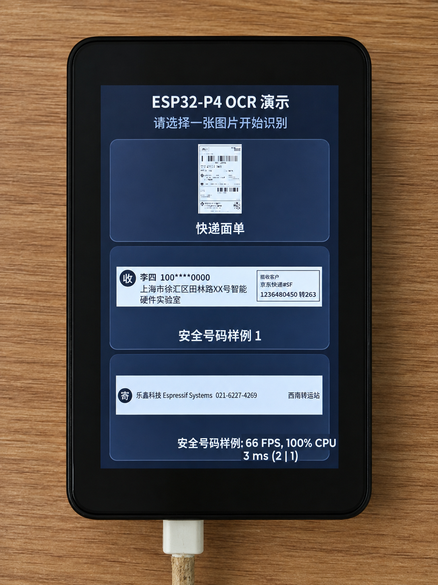
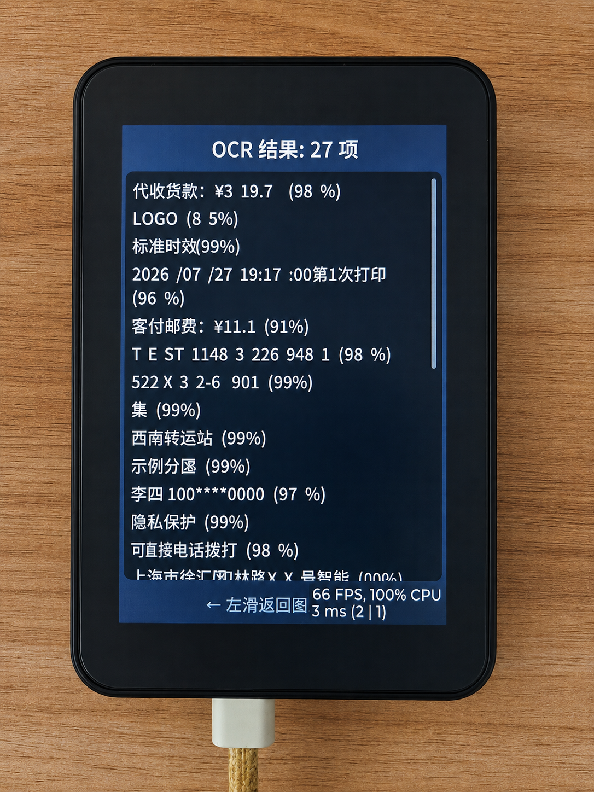
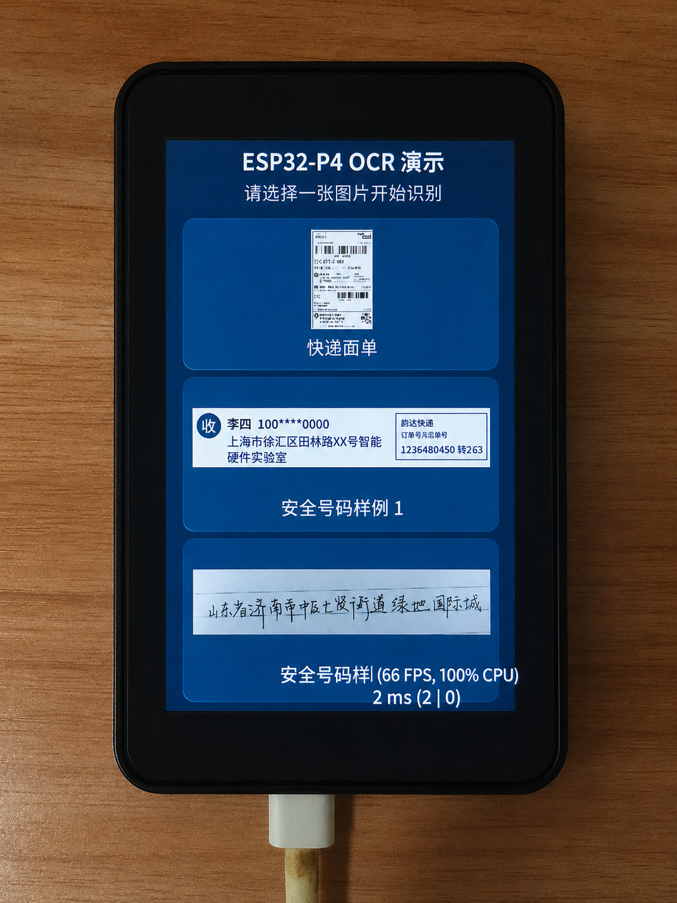
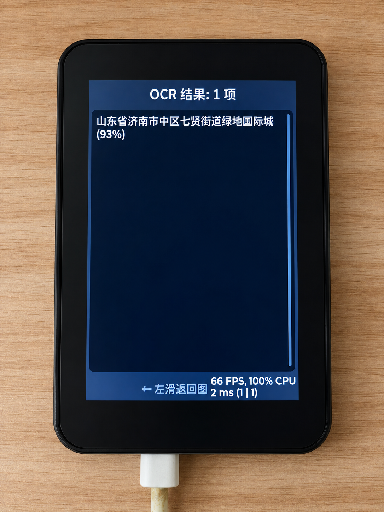

# ESP32-P4 Shipping Label OCR

  English | <a href="README.zh-CN.md">简体中文</a>

An on-device OCR system powered by the **PP-OCRv6** models from [ESP-DL](https://github.com/espressif/esp-dl). This project reproduces the OCR example from Espressif's esp-dl repository and ports it to a different hardware platform: the **ESP32-P4 with a Waveshare 3.5-inch touchscreen**.

> **Key differences from the original esp-dl example:** Espressif's official OCR example targets ESP32-S3 boards such as the ESP32-S3-EYE and Korvo-2. This project reproduces the complete pipeline on the ESP32-P4—JPEG decoding → PP-OCRv6 text detection and recognition → result display on an LVGL touchscreen—with dedicated adaptations for the P4's dual-core architecture, high-capacity flash, and PPA hardware acceleration.

## Results

| Shipping labels | Masked phone number recognition |
|:---:|:---:|
|  |  |
|  |  |

## Hardware

| Module | Specification |
|:---|:---|
| MCU | [ESP32-P4](https://www.espressif.com/en/products/socs/esp32-p4) (dual-core 400 MHz, 32 MB PSRAM) |
| Development board | [Waveshare ESP32-P4-WIFI6-Touch-LCD-XC](https://www.waveshare.com/wiki/ESP32-P4-WIFI6-Touch-LCD-XC) |
| Display | 3.5-inch 320×480 capacitive touchscreen |
| Storage | 16 MB flash (8 MB application + 7 MB font partition) |

## OCR Models

This project uses the two-stage **PP-OCRv6** models provided by ESP-DL and packaged by the `pp_ocr_v6` component:

| Stage | Model | File | Input | Size |
|:---|:---|:---|:---|:---|
| Text detection | Det (S8) | `pp_ocr_v6_det_s8.espdl` | Full image → text box coordinates | 649 KB |
| Text recognition | Rec (S16) | `pp_ocr_v6_rec_s16.espdl` | 48×320 text-line crop | 2.4 MB |

The current configuration uses **SHORT mode**, with a total model size of approximately **3 MB**. INT16 precision is used by default to balance accuracy and speed. INT8 models (1.2 MB, faster) and LONG mode (48×640, for longer text lines) are also available.

## Project Structure

| Module | Files | Responsibility |
|:---|:---|:---|
| **main** | `main.cpp` | Startup flow: initialize storage and UI, then start the demo or benchmark |
| **demo_controller** | `demo_controller.cpp/.hpp` | OCR worker and request queue, image selection, busy state, and return navigation |
| **app_storage** | `app_storage.cpp/.hpp` | NVS initialization, font partition memory mapping, and asset loading |
| **app_ui** | `app_ui.cpp/.hpp` | LVGL UI: image selector, OCR preview, and result cards |
| **ocr_pipeline** | `ocr_pipeline.cpp/.hpp` | JPEG decoding → PP-OCRv6 inference → result formatting |
| **demo_images** | `demo_images.cpp/.hpp` | Registration and management of built-in demo images |

## Technical Highlights

- **Dual-core workload separation:** Core 0 handles LVGL rendering and touchscreen interaction, while Core 1 runs OCR inference; the two are decoupled through a FreeRTOS queue.
- **Persistent models:** The `PPOCRV6` instance remains loaded after the first inference, avoiding repeated initialization for subsequent images.
- **PPA acceleration:** The ESP32-P4's PPA (Pixel Processing Accelerator) accelerates LVGL rendering.
- **Memory-mapped font assets:** The complete CJK font, approximately 3.9 MB, is mapped directly from flash as read-only memory with `esp_mmap_assets`, consuming no PSRAM. See [`docs/font_flash_mmap.md`](docs/font_flash_mmap.md) for details.

## License

[Apache-2.0](LICENSE)

Font licenses:

- [`main/font_assets/LICENSE-DroidSansFallbackFull.txt`](main/font_assets/LICENSE-DroidSansFallbackFull.txt)
- [`main/font_assets/LICENSE-demo-fallback.txt`](main/font_assets/LICENSE-demo-fallback.txt)
