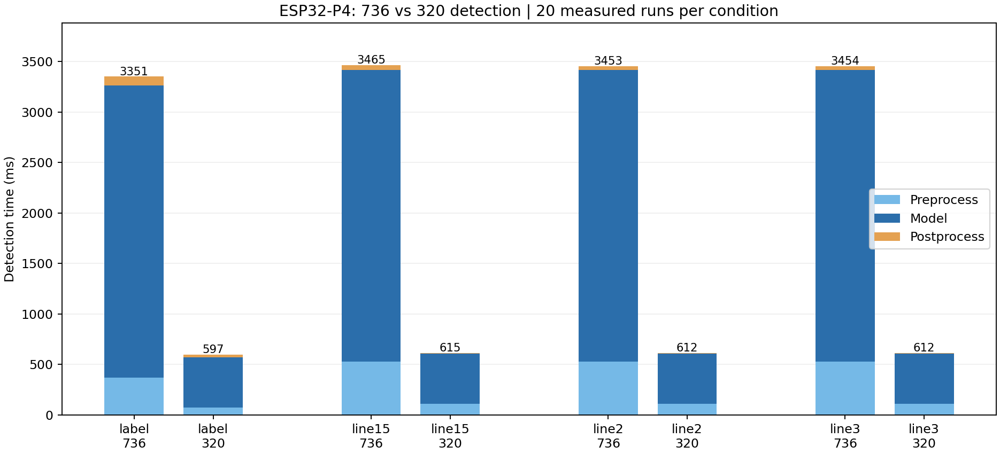
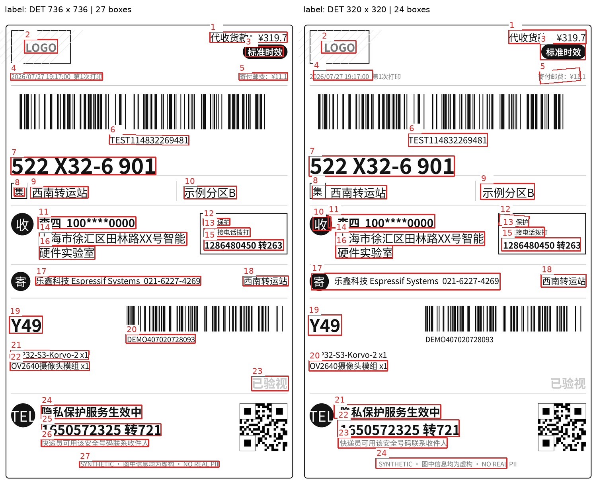
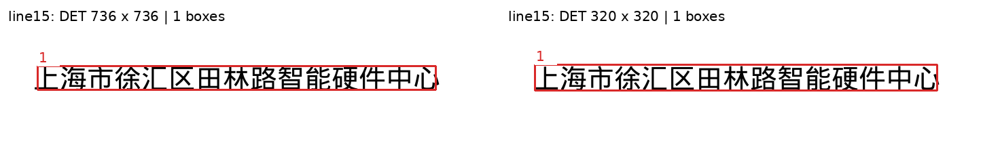
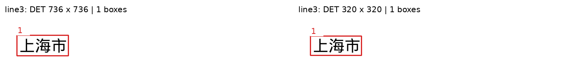

# 736×736 与 320×320 检测实验结果

2026-11-13，在 `/dev/ttyACM0` 连接的 ESP32-P4 上完成全部实验。
每个条件正式20次，另有两批各3次预热；合计160次正式检测、48次预热、8次辅助OCR。
所有条件都通过实际输入/输出形状检查。串口采集期间未检测到崩溃、复位或看门狗错误。

硬件与软件：CPU 360 MHz、PSRAM 200 MHz、ESP-IDF v5.5.4、Debug优化、Core 1单核。
使用原有检测模型与量化参数；736保持默认输入，320使用构造参数覆盖尺寸，无需重新导出模型。
基线提交为 `6ce59fe17909e5d88e6d6be77cfb1faf41db8be9`，测试固件差异及校验值见run01。

## 测得的平均检测总耗时

| 样本 | 736×736 | 320×320 | 加速倍数 | 耗时下降 |
|---|---:|---:|---:|---:|
| 完整快递面单 | 3351.141 ms | 597.053 ms | 5.613× | 82.18% |
| 单行15字 | 3464.959 ms | 614.731 ms | 5.637× | 82.26% |
| 单行2字 | 3452.718 ms | 611.689 ms | 5.645× | 82.28% |
| 单行3字 | 3454.238 ms | 611.997 ms | 5.644× | 82.28% |

计时范围为检测前处理、模型推理和检测后处理；不包含JPEG解码、模型初始化、Rec及显示。
这是当前配置下的稳定运行耗时，不是硬件经全部优化后的理论极限。



## 实验一：降低尺寸明显提速，同时出现小字漏检

完整面单检测框数由27变为24，20次运行中各自框数保持一致。
辅助OCR中通过置信度阈值的结果由27项变为23项。
这些数量不是文字准确率；人工核对检测框图和识别文本后，有以下可见变化：

- 320漏掉了下方条码编号、`ESP32-S3-Korvo-2 X1` 和“已验视”区域。
- 时间戳框未完整覆盖原来的“第1次打印”等文字。
- “集”和“西南转运站”合并为一个框。
- 寄件信息行与左侧“寄”图标合并，辅助识别置信度降至约0.433，低于0.5而被过滤。
- 320也新检测到了“收”图标，因此不能用27−24直接当作漏掉的文字行数。



## 实验二：同一尺寸下，字数减少对Detect提速很小

15字与2字相比，736下检测总时间只减少12.241 ms（0.35%），320下只减少3.042 ms（0.49%）。
15字与3字相比，差异分别为10.721 ms（0.31%）和2.734 ms（0.44%）。

三个受控样本的纯模型推理时间非常接近：736约2891.7–2891.9 ms，320约496.3 ms。
主要变化来自后处理：15字/2字的后处理在736下分别为46.594/34.141 ms，
在320下分别为9.358/6.270 ms。

这与固定尺寸网络每次计算整个输入的执行方式一致。仅减少图中文字数量，
不会像减小检测输入尺寸一样明显减少网络计算。

三张受控图片在两种尺寸下都得到一个框；额外的一次辅助OCR均完整识别出预期文本：

| 样本 | 预期与实际识别文本 | 736置信度 | 320置信度 |
|---|---|---:|---:|
| 15字 | 上海市徐汇区田林路智能硬件中心 | 0.999870 | 0.998969 |
| 2字 | 上海 | 1.000000 | 1.000000 |
| 3字 | 上海市 | 0.999997 | 0.999998 |

本结果只说明这组白底黑字、40 px字号样本通过，不能推广为320对所有单行文字均无精度损失。





## 原始数据和复现

- [完整统计报告](run01/report.md)：分阶段均值、中位数、P95、检测框和全部辅助识别文本。
- [逐次数据](run01/runs.csv)：208行，包含预热标记；正式数据为160行。
- [统计汇总](run01/summary.csv)：8种条件，包含每批均值、标准差与极值。
- [结构化事件](run01/events.jsonl)及[完整串口日志](run01/raw_serial.log)。
- [测试固件来源及校验值](run01/provenance.json)、[测试配置](run01/sdkconfig.test)、[配置基线](sdkconfig.baseline)。
- [构建日志](build.log)及[烧录日志](flash.log)。
- [实验模式使用说明](../../docs/ocr_benchmark.md)。

原始事件中的 `model.batch=0` 是辅助识别阶段，其 `init_us=0` 表示未单独计时。
模型初始化比较应使用 `batch=1/2` 的实测值。

本机用户目录的NumPy 2与系统Matplotlib存在ABI冲突，生成图表时使用系统Python包，
无需修改全局依赖。成功执行的分析命令为：

```bash
PYTHONNOUSERSITE=1 MPLCONFIGDIR=/tmp/ocr_benchmark_mpl \
  python3 tools/analyze_ocr_benchmark.py experiments/ocr_detect_2026-11-13/run01
```

图表分析环境为NumPy 1.21.5、Matplotlib 3.5.1、Pillow 9.0.1。样本生成环境另记于样本manifest。
统计使用Python标准库，图表依赖问题不影响已经采集的板上测量值。
