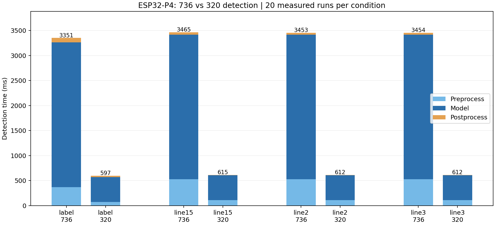
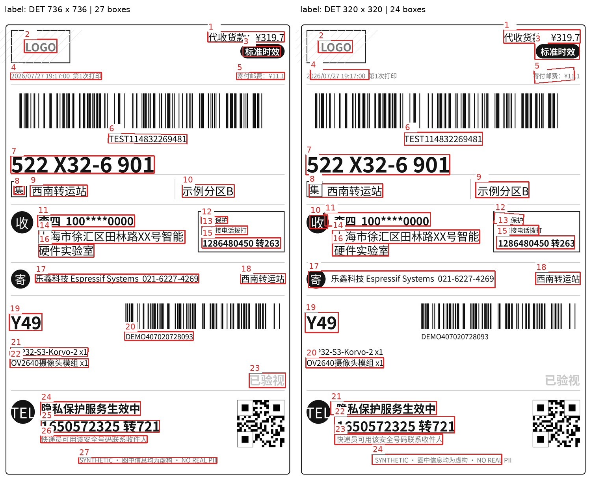
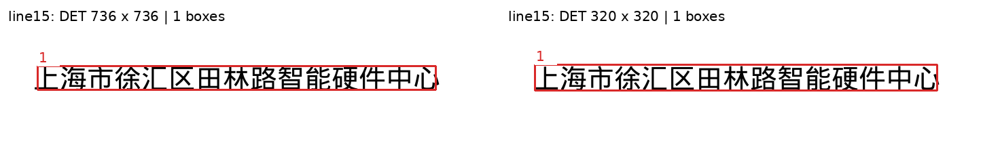
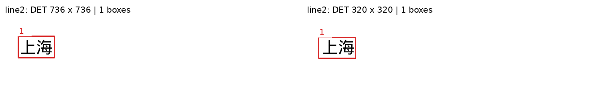
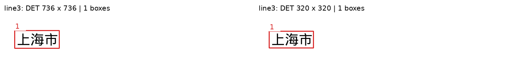

# ESP32-P4 OCR 检测尺寸实验

以下数值均来自本次板上实测，不使用官方基准或面积比例推算。

采集时间：2026-11-13T19:58:29.317549+08:00。基线提交：`6ce59fe17909e5d88e6d6be77cfb1faf41db8be9`。

CPU 360 MHz；PSRAM 200 MHz；优化配置 debug；Core 1 单核、任务优先级 5；芯片修订 103；v5.5.4。

## 方法

同一固件、相同 INT8 检测模型；736 使用模型默认形状，320 在构造时覆盖输入。所有输入/输出形状均通过设备端检查。检测阈值为 0.2，框阈值 0.4，unclip 1.4，最小尺寸 3。

完整面单使用原图 750×1170。15/2/3 字样本均为 736×736 白底黑字、Droid Sans Fallback Full 40 px、起点 (48,320)。测试样本、字体与固件 SHA-256 记录在 provenance.json。

每种条件两批各10次，批前预热3次。第一批736→320，第二批320→736；正式160次，预热48次。JPEG每张仅解码一次；模型加载、Rec、日志输出和屏幕绘制均在检测计时区间之外。LVGL保持静态测试页面，原有后台任务仍运行。

检测总时间在 Det::run() 外测量；三个阶段在函数内计时。P95 使用 nearest-rank，20次中的第19个排序值。两批各自均值、标准差、最小/最大值见 summary.csv。

## 耗时（毫秒）

| 样本 | 尺寸 | 前处理均值 | 推理均值 | 后处理均值 | 总耗时均值 | 中位数 | P95 | 框数范围 |
|---|---:|---:|---:|---:|---:|---:|---:|---:|
| 完整面单 | 736 | 371.763 | 2892.591 | 86.782 | 3351.141 | 3351.144 | 3351.512 | 27–27 |
| 完整面单 | 320 | 73.846 | 496.137 | 27.065 | 597.053 | 597.053 | 597.177 | 24–24 |
| 单行15字 | 736 | 526.501 | 2891.859 | 46.594 | 3464.959 | 3464.956 | 3465.277 | 1–1 |
| 单行15字 | 320 | 109.046 | 496.322 | 9.358 | 614.731 | 614.725 | 614.786 | 1–1 |
| 单行2字 | 736 | 526.854 | 2891.717 | 34.141 | 3452.718 | 3452.624 | 3453.262 | 1–1 |
| 单行2字 | 320 | 109.106 | 496.308 | 6.270 | 611.689 | 611.703 | 611.745 | 1–1 |
| 单行3字 | 736 | 526.915 | 2891.761 | 35.557 | 3454.238 | 3454.151 | 3454.750 | 1–1 |
| 单行3字 | 320 | 109.099 | 496.329 | 6.563 | 611.997 | 612.002 | 612.042 | 1–1 |

## 尺寸对比

| 样本 | 总耗时加速 | 总耗时下降 | 纯模型加速 |
|---|---:|---:|---:|
| 完整面单 | 5.613× | 82.18% | 5.830× |
| 单行15字 | 5.637× | 82.26% | 5.827× |
| 单行2字 | 5.645× | 82.28% | 5.826× |
| 单行3字 | 5.644× | 82.28% | 5.826× |

## 文字长度对比

| 尺寸 | 15字总耗时 | 2字总耗时 | 3字总耗时 | 15字/2字 | 15字/3字 |
|---|---:|---:|---:|---:|---:|
| 736 | 3464.959 | 3452.718 | 3454.238 | 1.004× | 1.003× |
| 320 | 614.731 | 611.689 | 611.997 | 1.005× | 1.004× |

## 检测框与辅助识别

红框来自第一批第10次正式检测，编号按检测器输出顺序。不同尺寸的编号不保证对应同一块文字。辅助识别在计时实验之外执行，沿用48×320 INT16 Rec，score≥0.5才为accepted。原图始终保留，Rec从原图裁剪。框数不能直接当作准确率，需结合图像检查漏检、拆框和合框。

### 完整面单

| Detect尺寸 | 框编号 | 识别文本 | 置信度 | 保留 |
|---|---:|---|---:|---|
| 736 | 1 | 代收货款：¥319.7 | 0.9834 | 是 |
| 736 | 2 | LOGO | 0.8576 | 是 |
| 736 | 3 | 标准时效 | 0.9992 | 是 |
| 736 | 4 | 2026/07/2719:17:00第1次打印 | 0.9689 | 是 |
| 736 | 5 | 客付邮费：¥11.1 | 0.9188 | 是 |
| 736 | 6 | TEST114832269481 | 0.9852 | 是 |
| 736 | 7 | 522 X32-6 901 | 0.9912 | 是 |
| 736 | 8 | 集 | 0.9997 | 是 |
| 736 | 9 | 西南转运站 | 0.9965 | 是 |
| 736 | 10 | 示例分区B | 0.9999 | 是 |
| 736 | 11 | 李四 100****0000 | 0.9736 | 是 |
| 736 | 12 | 隐私保护 | 1.0000 | 是 |
| 736 | 13 | 可直接电话拨打 | 0.9899 | 是 |
| 736 | 14 | 上海市徐汇区田林路XX号智能 | 0.9936 | 是 |
| 736 | 15 | 1286480450转263 | 1.0000 | 是 |
| 736 | 16 | 硬件实验室 | 0.9999 | 是 |
| 736 | 17 | 乐鑫科技EspresifSystems 02-6227-4269 | 0.8015 | 是 |
| 736 | 18 | 西南转运站 | 0.9996 | 是 |
| 736 | 19 | Y49 | 0.9995 | 是 |
| 736 | 20 | DEM0407020728093 | 0.9854 | 是 |
| 736 | 21 | ESP32-S3-Korvo-2 X1 | 0.9323 | 是 |
| 736 | 22 | OV2640摄像头模组 x1 | 0.9615 | 是 |
| 736 | 23 | 已验视 | 0.9992 | 是 |
| 736 | 24 | 隐私保护服务生效中 | 1.0000 | 是 |
| 736 | 25 | 1650572325 转721 | 0.9763 | 是 |
| 736 | 26 | 快递员可用该安全号码联系收件人 | 0.9992 | 是 |
| 736 | 27 | SYNTHETIC·图中信息均为虚构·NOREAL I | 0.9175 | 是 |
| 320 | 1 | 代收货款：¥319.7 | 0.9735 | 是 |
| 320 | 2 | LOG0 | 0.8241 | 是 |
| 320 | 3 | 标准时效 | 0.9666 | 是 |
| 320 | 4 | 026/07/27 19:17:00 | 0.9786 | 是 |
| 320 | 5 | 寄付邮费:¥11 | 0.9557 | 是 |
| 320 | 6 | TEST114832269481 | 0.9978 | 是 |
| 320 | 7 | 522 X32-6 901 | 0.9790 | 是 |
| 320 | 8 | 集西南转运站 | 0.9992 | 是 |
| 320 | 9 | 示例分区B | 0.9993 | 是 |
| 320 | 10 | 收 | 1.0000 | 是 |
| 320 | 11 | 李四 100****0000 | 0.9682 | 是 |
| 320 | 12 | 隐私保护 | 1.0000 | 是 |
| 320 | 13 | 可直接电话拨扑 | 0.8893 | 是 |
| 320 | 14 | 上海市徐汇区田林路XX号智能 | 0.9937 | 是 |
| 320 | 15 | 1286480450转263 | 0.9996 | 是 |
| 320 | 16 | 硬件实验室 | 0.9999 | 是 |
| 320 | 17 | 寄乐鑫科Espres yte0162126 | 0.4333 | 否 |
| 320 | 18 | 西南转运站 | 0.9996 | 是 |
| 320 | 19 | Y49 | 0.9730 | 是 |
| 320 | 20 | OV2640摄像头模组 ×1 | 0.9261 | 是 |
| 320 | 21 | 隐私保护服务生效中 | 0.9472 | 是 |
| 320 | 22 | 1650572325 转721 | 0.9840 | 是 |
| 320 | 23 | 快递员可用该安全号码联系收件人 | 0.9716 | 是 |
| 320 | 24 | SYNTHETIC·图中信息均为虚构·NO REAL | 0.9486 | 是 |

### 单行15字

| Detect尺寸 | 框编号 | 识别文本 | 置信度 | 保留 |
|---|---:|---|---:|---|
| 736 | 1 | 上海市徐汇区田林路智能硬件中心 | 0.9999 | 是 |
| 320 | 1 | 上海市徐汇区田林路智能硬件中心 | 0.9990 | 是 |

### 单行2字

| Detect尺寸 | 框编号 | 识别文本 | 置信度 | 保留 |
|---|---:|---|---:|---|
| 736 | 1 | 上海 | 1.0000 | 是 |
| 320 | 1 | 上海 | 1.0000 | 是 |

### 单行3字

| Detect尺寸 | 框编号 | 识别文本 | 置信度 | 保留 |
|---|---:|---|---:|---|
| 736 | 1 | 上海市 | 1.0000 | 是 |
| 320 | 1 | 上海市 | 1.0000 | 是 |

## 数据文件

- raw_serial.log：完整串口原始输出。
- events.jsonl：原始结构化事件，包含预热、形状和框坐标。
- runs.csv：208次逐次数据，warmup列区分预热。
- summary.csv：8个条件的统计值。
- provenance.json、sdkconfig.test、tracked_changes.patch：可复现实验信息。

## 适用范围

结果反映当前板卡、固件与这四张样本的检测性能。总耗时不包含模型首次加载、JPEG解码、Rec和UI；不能直接作为完整OCR吞吐量。受控文字只有一种字体、字号和背景，不能代表不同距离、光照、倾斜或小字场景。
